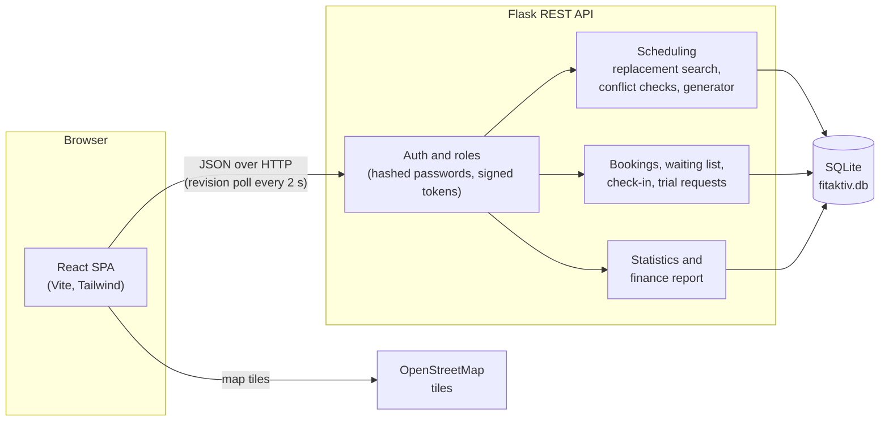
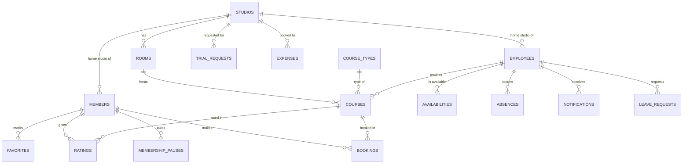

<div align="center">


# Fit & Aktiv

[](https://github.com/toumiamine12/Fit-Aktiv/actions/workflows/tests.yml)


Course planning, booking and back-office platform for a chain of 22 gyms.
It replaces paper rosters and phone bookings with one system for visitors, members, trainers and admins,
including automatic replacement planning when a trainer reports sick.


</div>

> Fit & Aktiv is a fictional chain with 22 studios on the Lower Rhine (Krefeld, Düsseldorf,
> Mönchengladbach, Duisburg, Essen and more). The UI is in German, as the product targets gyms
> in Germany. The demo database holds 22 studios, 44 rooms, 110 staff accounts, about 25,000
> members, about 11,500 courses for the current year and 18,000+ bookings.

## Contents

- [Features](#features)
- [Tech stack](#tech-stack)
- [Architecture](#architecture)
- [Repository structure](#repository-structure)
- [Quickstart](#quickstart)
- [Configuration](#configuration)
- [Usage examples](#usage-examples)
- [Implementation notes](#implementation-notes)
- [Screenshots](#screenshots)
- [Roadmap](#roadmap)

## Features

### Public website
- Interactive studio map (Leaflet + OpenStreetMap) synced with a studio list; selecting a studio opens its timetable
- Weekly timetable for all studios with week navigation and studio filter
- Trial-session form, stored in the database and delivered to admins as a notification

### Members
- Self-service registration, login and password reset by e-mail (one-time link, valid for 1 hour)
- Course booking with server-side rules: room capacity, no double booking, no booking of cancelled or started courses
- Waiting list with automatic promotion when a place frees up; cancellation up to 2 hours before the start
- Own bookings with ratings and calendar export (`.ics`)
- Training history: attended courses, streaks, hours per month and course type
- Home workouts: 29 exercises with start and end photos, five guided routines with a timer
- Membership: four plans, plan change from next month, pauses (max. 3 months a year), digital membership card with QR code

### Trainers
- Agenda with the next course, a two-week calendar of working days and a month overview
- Weekly availability for the next four weeks, checked against contract hours
- Leave requests with admin approval; sick notes trigger the automatic replacement search
- QR check-in: scan membership cards with the phone camera, or tick members off by hand
- Calendar export (`.ics`) of all upcoming shifts

### Admins
- Overview of pending work (trial requests, leave requests, courses without a trainer), monthly finances, studio occupancy and trainer workload
- Member search over 25,000 records with filters by studio and plan
- Staff management with salaries, course management with conflict checking, and generators for weekly or yearly schedules
- Statistics for finances, members and courses (occupancy, no-shows, ratings, busiest times)
- Monthly BWA (*Betriebswirtschaftliche Auswertung*, the report German accountants use) as a two-page A4 PDF
- Simulated e-mail outbox for waiting-list promotions, trainer changes, cancellations and password resets

### Platform
- Role-based access: visitor, member, trainer, admin; `/api/data` returns only what the caller may see
- Salted scrypt password hashes, signed tokens with 7-day expiry, login lockout after 5 failed attempts
- Live sync: the UI polls a ~100-byte revision endpoint and reloads data only when the database changed, including edits made directly in the SQLite file
- Automatic schema migrations on startup, so older databases keep working

## Tech stack

| Layer | Technologies |
|---|---|
| Frontend | React 19, Vite 8, Tailwind CSS 4, shadcn/ui, Componentry, Framer Motion, GSAP, Leaflet, lucide icons |
| Backend | Python 3.10+, Flask 3, Flask-CORS, Werkzeug (password hashing, proxy support) |
| Database | SQLite, 19 tables with foreign keys, created and migrated automatically |
| Auth | scrypt password hashes, HMAC-SHA256 signed bearer tokens, per-endpoint role checks, login rate limiting |
| Testing and CI | pytest (14 API tests), GitHub Actions |
| Delivery | Docker Compose: nginx serves the built frontend and proxies `/api` to Flask |

## Architecture



<details>
<summary>Data model</summary>



</details>

## Repository structure

```text
Fit-Aktiv/
├── backend/
│   ├── app.py                  # Flask API: auth, scheduling, booking, statistics, finance
│   ├── database.py             # schema, migrations, demo data
│   ├── tests/                  # pytest API tests (fresh seeded database per test)
│   ├── requirements.txt
│   ├── requirements-dev.txt    # adds pytest
│   └── Dockerfile
├── frontend/
│   ├── src/
│   │   ├── App.jsx             # app shell, role-based routing, login
│   │   ├── Home.jsx            # public homepage, trial-session form
│   │   ├── MemberArea.jsx      # member dashboard, bookings, profile
│   │   ├── TrainerAgenda.jsx   # trainer agenda (+ Availability, LeaveRequests, Attendance)
│   │   ├── AdminPortal.jsx     # admin layout (+ AdminOverview, AdminMembers, StatsDashboard, FinanceReport)
│   │   ├── WeekPlan.jsx        # weekly timetable shared by all roles
│   │   ├── calendar.js         # .ics export
│   │   ├── api.js              # API client
│   │   └── styles.css          # design system, print styles for the BWA
│   ├── public/images/
│   ├── nginx.conf              # used by the Docker image
│   ├── Dockerfile
│   └── package.json
├── docs/screenshots/
├── .github/workflows/tests.yml # CI: backend tests + frontend build
├── compose.yaml
└── LOGIN_DETAILS.md            # all 110 demo staff logins
```

## Quickstart

### Prerequisites

| Setup | Requirements |
|---|---|
| Docker | Docker with Compose v2 (or Podman with a compose provider) |
| Local | Python 3.10+, Node.js 20.19+ or 22.12+, npm |

### Option A: Docker

```bash
git clone https://github.com/toumiamine12/Fit-Aktiv.git
cd Fit-Aktiv
echo "FITAKTIV_AUTH_SECRET=$(openssl rand -hex 32)" > .env   # read by docker compose, ignored by git
docker compose up --build
```

Open **http://localhost:8080**. The first start generates the demo data and the year's courses,
so the API needs a few seconds before the first login works. Data persists in the `db` volume;
`docker compose down -v` resets it.

### Option B: Local development

```bash
git clone https://github.com/toumiamine12/Fit-Aktiv.git
cd Fit-Aktiv

# Terminal 1: API on http://127.0.0.1:5000
cd backend
python3 -m venv venv
source venv/bin/activate              # Windows: venv\Scripts\activate
pip install -r requirements.txt
FITAKTIV_DEBUG=1 python3 app.py       # auto-reload; creates backend/fitaktiv.db on first start

# Terminal 2: frontend on http://localhost:5173 (proxies /api to the backend)
cd frontend
npm install
npm run dev
```

To start over with fresh demo data, stop the backend, delete `backend/fitaktiv.db` and start it again.

### Demo accounts

All demo accounts use the password `pass123`. Choose **Mitglied** (member) or **Mitarbeiter** (staff) on the login page.

| Role | E-mail |
|---|---|
| Admin | `lisa.weber@fit-aktiv.local` |
| Trainer | `max.bauer@fit-aktiv.local` (all staff: [LOGIN_DETAILS.md](LOGIN_DETAILS.md)) |
| Member | `philipp.winter.2@example.local` (with booking history), `mitglied01@example.local` … `mitglied30@example.local` |

Passwords you set yourself (registration, password change, new staff) need at least 8 characters.
E-mails are not sent; they appear in the admin's **E-Mail-Ausgang** (outbox), including password reset links.

## Configuration

All settings are environment variables. The defaults are meant for local development.

| Variable | Description | Default | Required |
|---|---|---|---|
| `FITAKTIV_AUTH_SECRET` | Secret for signing login tokens | development value | Yes, in production and Docker |
| `FITAKTIV_ENV` | `production` refuses to start without `FITAKTIV_AUTH_SECRET` | unset | No (set in the Docker image) |
| `FITAKTIV_DEBUG` | `1` enables Flask's auto-reload and debugger; never on a reachable host | off | No |
| `FITAKTIV_HOST` | Address the API listens on | `127.0.0.1` | No |
| `FITAKTIV_DB` | Path of the SQLite database | `backend/fitaktiv.db` | No |
| `FITAKTIV_PUBLIC_URL` | Base URL for links in e-mails (password reset) | `http://localhost:5173` | No |
| `FITAKTIV_BEHIND_PROXY` | `1` trusts `X-Forwarded-For`, so login limits use the real client address | off | Behind a reverse proxy |
| `FITAKTIV_AUTO_YEAR_COURSES` | `0` skips generating the yearly schedule on startup | `1` | No |
| `FITAKTIV_LAN` | `1` serves the dev frontend over HTTPS on the local network (camera access for QR check-in on phones) | off | No |

## Usage examples

### Call the API

```bash
API=http://localhost:5173/api   # Docker: http://localhost:8080/api

# Log in as a member and keep the token
TOKEN=$(curl -s "$API/login" -H 'Content-Type: application/json' \
  -d '{"email":"mitglied01@example.local","password":"pass123","account_type":"member"}' \
  | python3 -c 'import sys, json; print(json.load(sys.stdin)["token"])')

# Book a place in course 42 (or join its waiting list when it is full)
curl -s -X POST "$API/courses/42/booking"  -H "Authorization: Bearer $TOKEN"
curl -s -X POST "$API/courses/42/waitlist" -H "Authorization: Bearer $TOKEN"

# Cheap change detection, as used by the frontend
curl -s "$API/revision"
```

```json
{"ok": true, "revision": {"date": "2026-10-10", "db_mtime": 1791580993.64, "updated_at": "2026-10-10 11:06:01"}}
```

### Phone demo with QR check-in

```bash
cd frontend
FITAKTIV_LAN=1 npm run dev   # https://<laptop-ip>:5173, self-signed certificate
```

Phones only allow camera access on secure pages; accept the certificate warning once.

### Run the tests

```bash
cd backend
pip install -r requirements-dev.txt
pytest -q tests
```

The tests cover password hashing, login lockout, token expiry and tampering, role checks,
password change and reset, bookings with waiting-list promotion, the replacement-trainer
search and the revision endpoint. Each test runs against a fresh copy of a seeded database.

<details>
<summary>API endpoints</summary>

| Method | Endpoint | Access | Purpose |
|---|---|---|---|
| `GET` | `/api/data` | everyone (filtered by role) | Studios, rooms, courses, stats, role-specific data |
| `GET` | `/api/revision` | everyone | Change marker for live sync |
| `POST` | `/api/login` | everyone | Log in as member or employee (rate limited) |
| `POST` | `/api/members/register` | everyone | Create a member account |
| `POST` | `/api/password-reset` | everyone | Send a reset link to the outbox |
| `POST` | `/api/password-reset/confirm` | everyone | Set a new password with a reset token |
| `PATCH` | `/api/members/me`, `/api/employees/me` | owner | Update own profile; password change needs the current password |
| `POST` | `/api/trial-requests` | everyone | Request a trial session |
| `POST`, `DELETE` | `/api/courses/<id>/booking` | member | Book or cancel a place |
| `POST`, `DELETE` | `/api/courses/<id>/waitlist` | member | Join or leave the waiting list |
| `PUT`, `DELETE` | `/api/members/me/membership` | member | Change plan from next month, or withdraw the change |
| `POST`, `DELETE` | `/api/members/me/pauses[/<id>]` | member | Pause the membership |
| `POST`, `DELETE` | `/api/members/me/favorites` | member | Favourite courses and trainers |
| `POST` | `/api/courses/<id>/rating` | member | Rate an attended course |
| `GET` | `/api/attendance/today` | staff | Today's courses for check-in |
| `POST` | `/api/courses/<id>/scan` | staff | Check in a member by QR code |
| `PUT` | `/api/employees/<id>/availability` | admin or the trainer | Weekly availability |
| `POST` | `/api/employees/<id>/absence` | admin or the trainer | Sick note with automatic replacement search |
| `POST` | `/api/employees/<id>/available` | admin or the trainer | Back to work, restore own courses |
| `POST`, `DELETE` | `/api/leave-requests[/<id>]` | staff | Request planned leave |
| `POST` | `/api/leave-requests/<id>/decision` | admin | Approve or reject leave |
| `POST`, `PATCH`, `DELETE` | `/api/courses[/<id>]` | admin | Create, edit, delete courses |
| `POST` | `/api/courses/<id>/assign` | admin | Assign a trainer (with conflict check) |
| `POST` | `/api/courses/<id>/cancel` | admin | Cancel a course |
| `GET` | `/api/replacements?course_id=` | admin | Ranked replacement candidates |
| `POST` | `/api/courses/generate-week`, `/generate-year` | admin | Generate schedules |
| `POST`, `PATCH`, `DELETE` | `/api/employees[/<id>]` | admin | Manage staff |
| `POST` | `/api/studios` | admin | Add a studio |
| `GET` | `/api/stats` | admin | Statistics |
| `GET` | `/api/admin/overview` | admin | Overview page data |
| `GET`, `PATCH` | `/api/admin/members[/<id>]` | admin | Search members, change plans |
| `GET` | `/api/admin/finance?month=` | admin | Monthly BWA figures |
| `POST`, `DELETE` | `/api/admin/expenses[/<id>]` | admin | Record expenses |
| `GET`, `PATCH` | `/api/admin/trial-requests[/<id>]` | admin | Trial requests and their status |
| `GET` | `/api/emails` | admin | Simulated e-mail outbox |
| `POST` | `/api/notifications/<id>/read` | staff | Mark a notification as read |

</details>

## Implementation notes

**Replacement-trainer search.** When a trainer reports sick, each affected course is checked
against all other trainers. A candidate must hold the required qualification, not be absent,
have an availability window covering the course, stay below the weekly and monthly limits
(20 courses for full-time, 10 for part-time staff), have no overlapping course (with a
60-minute travel buffer between studios) and be allowed to travel if the course is outside
their home studio. Candidates are ranked by same studio, then mobility, then lowest workload.
Courses without a candidate are cancelled and booked members are notified. When the trainer
is back, untouched courses return to them.

**Schedule generation.** The first start fills the current year (about 11,000 courses) in
roughly 1.5 seconds, using in-memory indexes for availability, absences, load and time slots
instead of one query per check.

**Accounts and tokens.** Members and staff live in separate tables with overlapping IDs, so
member tokens are marked separately and can never reach staff endpoints. Tokens are
HMAC-SHA256 signed and expire after 7 days. Reset links store only the SHA-256 of the token,
take their domain from configuration rather than the request, and the endpoint answers the
same whether or not the account exists.

**Live sync.** `/api/data` is several megabytes. The frontend polls `/api/revision` every
2 seconds (database file modification time, latest change, today's date) and fetches the
full data only when the revision changes.

**Finance.** Revenue comes from each member's plan and pauses per month; costs are salaries
plus a flat 21 % employer social-security share, rent and energy per studio, and recorded
expenses. The overview, statistics and BWA use the same calculation. Salaries are never sent to trainers.

**Theming.** Champagne gold is the brand accent. Pages alternate between gold and a muted
sapphire in menu order; the top bar and admin sidebar always stay gold.

## Screenshots

### Public website

| Studio map | Course offer |
|---|---|
|  |  |
| **Public timetable** | **Trial-session request** |
|  |  |
| **Login (members and staff)** | **Mobile** |
|  |  |

### Member area

| Member dashboard | Booking a course |
|---|---|
|  |  |
| **My bookings** | **Training history** |
|  |  |
| **Home workouts** | **Membership card and plan** |
|  |  |

### Trainer workspace

| Timetable | QR check-in |
|---|---|
|  |  |

### Admin portal

| Overview | Statistics |
|---|---|
|  |  |
| **Finance report (BWA)** | **Members** |
|  |  |
| **Course management** | **Staff and salaries** |
|  |  |
| **Trial requests** | |
|  | |

## Roadmap

- [x] Salted password hashes, token expiry, login rate limiting
- [x] Password reset by e-mail
- [x] Revision-based live sync instead of full reloads
- [x] API test suite and CI
- [x] Docker Compose setup
- [ ] Production WSGI server (gunicorn) instead of Flask's built-in server
- [ ] PostgreSQL option for multi-instance deployments; rate-limit state in the database
- [ ] Real e-mail delivery (SMTP) instead of the simulated outbox
- [ ] Send only the visible date range of courses instead of the full year
- [ ] Frontend tests for booking and check-in flows


---

<div align="center">

Built by **Amine Toumi** · [GitHub @toumiamine12](https://github.com/toumiamine12)

</div>
